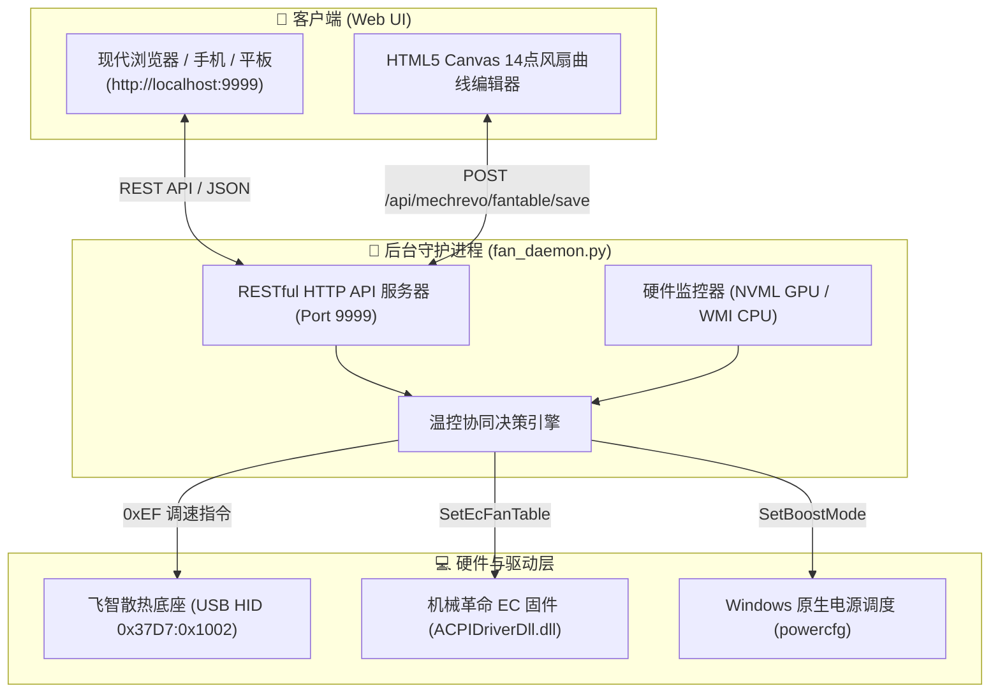

# 🌀 FlyMech Fan Control (飞智散热底座 + 机械革命笔记本智能温控协同系统)

> 🍃 **告别原厂臃肿后台与风扇暴鸣**：基于 USB HID 协议逆向与笔记本 ACPI/EC 驱动直连，实现飞智智能散热底座与机械革命游戏本内部双风扇的**全自动联合温控、独立 14 点风扇曲线编辑、0 RPM 静音停转与轻量级 Web 仪表盘**。

---

## 🌟 核心特性 (Features)

1. **🧊 飞智智能散热底座 (Flydigi BS2/BS2PRO) 协议直连**
   - 纯 Python `hidapi` 逆向直通 USB HID（VID: `0x37D7`, PID: `0x1002`），完全脱离官方臃肿的“飞智空间站”软件；
   - 实时双向通信：实时读取底座物理转速（1000 ~ 4000 RPM），并支持平滑自动温控调速（静音 1700、极速 2100、强冷 2600、超频 3100 及手动滑块无级变速）。

2. **🌀 机械革命 EC 硬件直连与双风扇独立控制**
   - 封装调用机械革命官方 ACPI/EC 内核驱动 (`ACPIDriverDll.dll` & `GCUService`)；
   - **支持 CPU / GPU 风扇独立调控与 0 RPM 静音停转**（低负载彻底零噪音）；
   - **交互式 14 点可视化风扇曲线编辑器**：网页端支持 HTML5 Canvas 鼠标拖拽调点、数值表格即时编辑，一键直接写入 EC 固件风扇表（FanTable）。

3. **📊 极简现代化 Web 控制台 (`http://localhost:9999`)**
   - 黑暗毛玻璃风格（Glassmorphism），手机、平板（串流远程）或本地浏览器随时自适应访问；
   - 毫秒级硬件监控：CPU 核心温度、RTX 独显温度、GPU 功耗 (W)、GPU 占用率 (%)、各风扇当前实时转速；
   - 机械革命一键性能模式切换：**办公模式 (35W) / 游戏模式 (50W) / 狂暴模式 (65W+)**。

4. **⚡ AMD Ryzen / Intel 睿频与温度优化**
   - 解锁 Windows 隐藏的处理器电源策略（`Processor performance boost mode` & `Maximum frequency`）；
   - 支持一键切换“3.3 GHz 极静锁频（消除 85℃ 瞬时积热）/ 3.8 GHz 黄金甜点 / 4.6 GHz 满血睿频”，让显卡独享散热与功耗空间。

5. **🍃 极致轻量，无感后台运行**
   - 内存占用仅 **< 15 MB**（原厂软件动辄 200MB+ 且容易崩溃死锁）；
   - 支持配置 Windows 计划任务以 `pythonw.exe` 开机后台无窗口自启。

---

## 🏗️ 架构与协议逆向 (Architecture & Protocols)



### 1. 飞智散热底座 HID 协议规范
* **Vendor ID / Product ID**: `0x37D7` / `0x1002`
* **控制包格式 (64 字节)**:
  - Byte 0: `0x55` (协议帧头)
  - Byte 1: `0xEF` (调速指令标识)
  - Byte 2: `0x0B` (固定载荷长度)
  - Byte 3: `0x00` (模式: 0=自动, 1=强效, 2=超频, 3=手动)
  - Byte 4: `Target_RPM & 0xFF` (目标转速低字节)
  - Byte 5: `(Target_RPM >> 8) & 0xFF` (目标转速高字节)
  - Byte 6..12: 校验位与保留位
* **转速回传包**:
  - Byte 4 为载荷长度 `0x0B`，Byte 8 与 Byte 9 组合为当前底座物理转速 `Real_RPM`。

### 2. 机械革命 EC 14点风扇表数据结构
每个风扇（CPU/GPU）在 EC 固件中拥有 14 个递进阶梯点：
```json
{
  "UpT": 55,            // 升温触发阈值 (℃)
  "DownT": 50,          // 降温回落阈值 (℃)
  "Duty": 15,           // 风扇目标占空比 (0-100%)
  "TempSlope": 1,       // 升温加速度响应
  "PloySlope": 1,       // 降温减速度响应
  "UpTempHoldTime": 2   // 迟滞平滑保持时间 (秒)
}
```

---

## 🚀 快速开始 (Quick Start)

### 1. 环境准备
确保系统安装了 **Python 3.8+** (Windows 10/11 x64)：
```bash
git clone https://github.com/zstzstzsta/flymech-fan-control.git
cd flymech-fan-control

# 安装依赖
pip install -r requirements.txt
```

### 2. 启动服务
```bash
# 前台调试运行
python fan_daemon.py

# 或者双击开机自启脚本无窗口静默运行
# pythonw fan_daemon.py
```

打开浏览器访问：**`http://localhost:9999`** 即可进入控制台！

---

## 📡 RESTful API 接口速查

| 端点 (Endpoint) | 方法 | 说明 |
| :--- | :--- | :--- |
| `/api/status` | `GET` | 获取系统温度、独显功耗、内部双风扇转速与底座状态 |
| `/api/cooler/mode` | `POST` | 切换散热底座挡位 (`{"mode": 0/1/2/3}`) |
| `/api/cooler/rpm` | `POST` | 手动设定散热底座目标转速 (`{"rpm": 1000~4000}`) |
| `/api/mechrevo/mode` | `POST` | 切换整机性能模式 (`{"mode": "office"/"gaming"/"turbo"}`) |
| `/api/mechrevo/fan` | `POST` | 切换内部风扇模式 (`{"fan": "cpu"/"gpu", "mode": 0~100}`) |
| `/api/mechrevo/fantable/save` | `POST` | 写入自定义 14 点 CPU/GPU 风扇曲线到 EC 固件 |

---

## ⚙️ 随开机后台自启配置 (Windows Task Scheduler)

使用管理员权限运行 PowerShell 配置无黑框自启计划任务：

```powershell
$Action = New-ScheduledTaskAction -Execute "pythonw.exe" -Argument "E:\vs_projects\fan_control\fan_daemon.py" -WorkingDirectory "E:\vs_projects\fan_control"
$Trigger = New-ScheduledTaskTrigger -AtLogOn
$Principal = New-ScheduledTaskPrincipal -UserId "$env:USERDOMAIN\$env:USERNAME" -LogonType Interactive -RunLevel Highest
Register-ScheduledTask -TaskName "FlydigiSmartFanDaemon" -Action $Action -Trigger $Trigger -Principal $Principal -Force
```

---

## 📜 开源协议 (License)

本项目基于 [MIT License](LICENSE) 开源。欢迎提 Issue 与 PR 喵！(=^･ω･^=)
